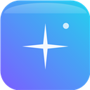

# GlassTab — Comet-style New Tab for Brave & Chrome

A glassmorphism New Tab page inspired by [Comet](https://www.perplexity.ai/comet):
an AI-first search bar over animated mesh gradients, frosted-glass cards, quick
links, weather, and deep customization. Built as a Manifest V3 extension —
no build step, no frameworks, no tracking.



## Features

- ✦ **AI-first search pill** — Enter searches with your browser's default
  engine; `Ask AI` hands off to Perplexity, ChatGPT, Claude, Duck.ai or a
  custom URL template
- 🧊 **Real glassmorphism** — backdrop-blur cards with adjustable blur,
  opacity and corner radius; animated mesh-gradient backgrounds (8 presets),
  solid colors, or your own image (URL or upload)
- 🕐 **Clock & greeting** — 12/24h, seconds, custom name
- 🔗 **Quick links** — most-visited sites via `chrome.topSites`, plus custom
  shortcuts; hide anything with the × button
- 🌦️ **Weather card** — Open-Meteo, no API key, city-based (no geolocation
  permission taken)
- 🔖 **Recent bookmarks** card
- 🎨 **Themes** — light / dark / auto, any accent color
- ♿ **Accessibility** — reduce-transparency mode, honors
  `prefers-reduced-motion`, full keyboard support (`/` focuses search,
  `Esc` closes settings)

## Install (Load unpacked)

1. Open `brave://extensions` (or `chrome://extensions`)
2. Enable **Developer mode** (top-right toggle)
3. Click **Load unpacked** → select this folder (`glasstab/`)
4. Open a new tab → Brave asks *"Keep these changes?"* → click **Keep it**

### Make it your home page too (one-time, 30 seconds)

Extensions can't set the Home button programmatically. If you want Home to
open GlassTab: Brave Settings → Appearance → turn on **Show home button** →
enter `brave://newtab` (it will open your overridden New Tab, which is
GlassTab).

> Prefer pointing Home at the extension page directly? After loading, copy
> the extension ID from `brave://extensions` and use
> `chrome-extension://<YOUR_ID>/index.html` as the home URL.

## Settings

Click the ⚙ on the page (top-right). Everything is stored in
`chrome.storage.sync`, so it follows your browser profile:

| Section | Options |
|---|---|
| Appearance | theme (auto/light/dark), accent color |
| Background | 8 mesh gradients, daily rotation, solid color, image URL/upload, dim |
| Glass | blur 0–40px, card opacity, corner radius, reduce transparency |
| Clock & greeting | show/hide, 12h, seconds, date, custom name |
| Cards | quick links, weather, bookmarks |
| Search | Enter action (search/ask AI), AI provider, custom template, new tab |

## Privacy

- No analytics, no remote code, no external requests except:
  - `api.open-meteo.com` / `geocoding-api.open-meteo.com` (weather, only when
    the weather card is used)
  - favicon lookups are served locally by the browser itself
- Uploaded background images never leave your machine (stored in
  `chrome.storage.local`)

## Project layout

```
glasstab/
├── manifest.json        # MV3
├── index.html
├── css/                 # themes, glass recipe, animations
├── js/                  # defaults, backgrounds, search, cards, settings, main
└── icons/               # generated via icons/make-icons.ps1 (GDI+)
```

## License

MIT
